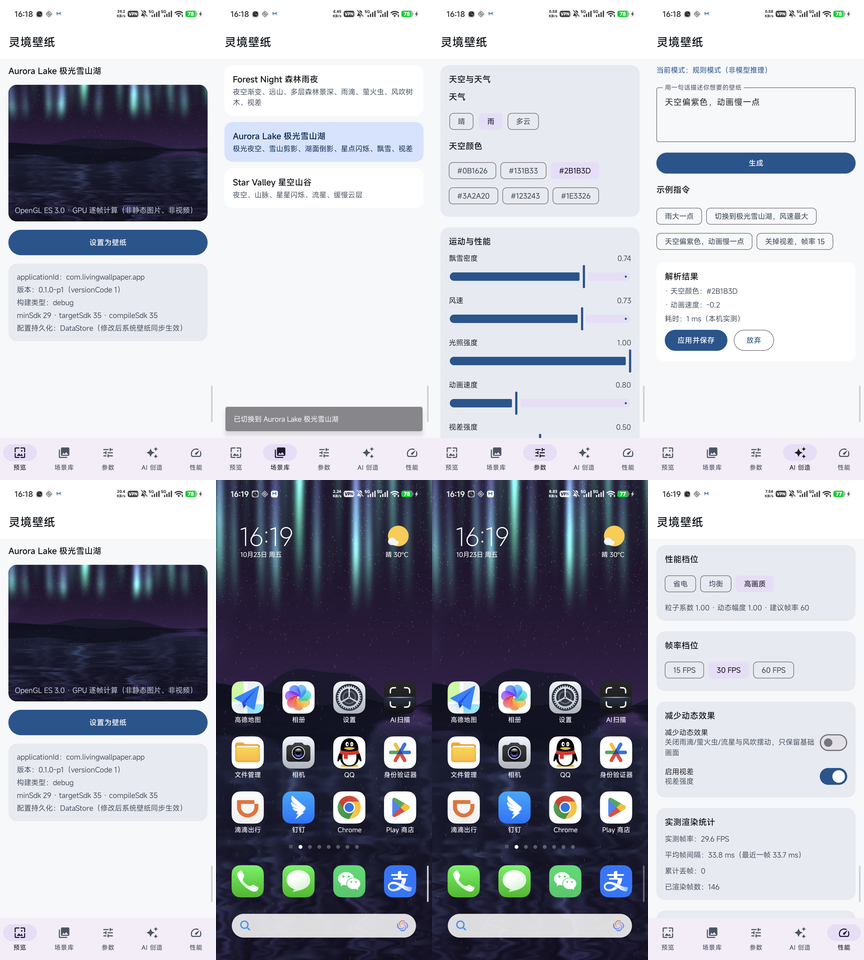

# 灵境 AI 动态壁纸 · LivingWallpaper

基于 **OpenGL ES 3.0** 的 Android 动态壁纸：画面由 GPU 逐帧实时计算，
不使用静态图片，不使用循环视频。

当前版本：`0.1.0`（已实现 P0–P8，真机验证通过，见 `docs/development-log.md`）



> 左起：实时预览 → 场景库 → 参数编辑 → 自然语言解析 → 应用后效果 → 壁纸选择 → 桌面生效 → 性能统计。
> 全部为真机截图（Xiaomi 14 Pro），演示视频 `docs/demo/demo.mp4`。

---

## 已实现功能

| 功能 | 状态 | 说明 |
|---|---|---|
| 系统动态壁纸服务 | 已实现（真机验证） | `WallpaperService.Engine` + 独立 GL 线程 + EGL 1.4 / OpenGL ES 3.0 |
| App 内实时预览 | 已实现（真机验证） | 与系统壁纸共用场景实现，但使用独立 EGL Surface 与 GL 线程 |
| Forest Night 森林雨夜 | 已实现 | 夜空渐变、远山、三层森林景深、雨滴、萤火虫、风吹树木、视差 |
| Aurora Lake 极光雪山湖 | 已实现 | 极光帘幕与星空、三层雪山剪影、湖面倒影与波光、飘雪 |
| Star Valley 星空山谷 | 已实现 | 星空闪烁、远/近山体、流星、缓慢云层 |
| Sunny Meadow 晴空草地 | 已实现（真机验证） | 隔着挂满雨水的玻璃看阳光下的草地：照片底图 + GLSL 水珠/水滴/雨丝与折射、视差 |
| 场景切换 | 已实现 | 场景库选择后，App 预览与系统壁纸同步切换 |
| 参数编辑器 | 已实现 | 天气、天空颜色、雨量、风速、光照、动画速度、视差、粒子密度、帧率 |
| 配置持久化 | 已实现 | DataStore Preferences，进程内单例供 UI 与壁纸共享 |
| 自然语言控制 | 已实现（规则模式） | **确定性规则匹配，不是大模型推理** |
| 性能档位 | 已实现 | 省电/均衡/高画质，真实改变粒子数量与动态幅度 |
| 性能监控 | 已实现 | 实测帧率、帧间隔、丢帧、内存，全部为真实测量 |
| 减少动态效果 / 关闭视差 | 已实现 | 关闭粒子与摆动；视差强度置 0 并注销传感器 |
| 生命周期与资源释放 | 已实现 | 不可见暂停渲染并注销传感器；Surface 销毁释放 EGL/GL 资源 |

## 明确未实现

> 以下均为真实状态，不做任何“看起来完成了”的表述。

- 端侧大模型（MNN / ONNX Runtime Mobile）推理——当前只有规则解析器，
  `AIProvider` 接口已预留，接入真实模型只需新增一个实现。
- 云端代理 / API Key 管理 / 提示词注入防护。
- 云端 A/B 实验、场景下载商城、用户账户体系、埋点与合规隐私中心。
- 物理求解的反射/折射、PBR 材质、Bloom、真实阴影。
  （City Dusk 的水珠折射是对底图采样点的偏移近似，不是光线追踪或厚度模型。）
- 本地 benchmark **模块**（Gradle 模块 + 基线对比）。目前是 `docs/measure_perf.py` 脚本，
  能自动采集 FPS 与 PSS，但没有做基线回归与 CI 门禁。
- 真实天气联动、AI 场景导演（时间轴关键帧）、iOS 展示端。

## 真机验证情况

验证设备：**Xiaomi 14 Pro（23116PN5BC）**，Android 16（SDK 36），
逻辑分辨率 1080×2400（物理 1440×3200 的 override），density 420。

**已验证：**

- APK 安装、冷启动、首页与四个场景的实际画面 —— 通过
- 系统动态壁纸设置（壁纸选择器 → 预览 → 应用），桌面实时渲染 —— 通过
- 场景切换、参数滑块实时影响画面 —— 通过
- `force-stop` 后重新设置壁纸，配置与场景保持 —— 通过
- 真机截图：见 `docs/shots/`，实测数据见 `docs/performance.md`

**仍未验证：**

- 旋转、锁屏、Surface 重建、低端机降级 —— 未系统测试
- 长时间连续运行（>1 小时）的掉帧与内存增长 —— 未测试
- Android Studio 打开工程 —— 未测试（开发机未安装 Android Studio）

**已知问题：**

- 系统壁纸**预览页**偶发全黑：通过 `ACTION_CHANGE_LIVE_WALLPAPER` 进入预览时，
  本机 HyperOS 上有时不为壁纸服务创建 Engine（logcat 无 `onSurfaceCreated`），
  预览区纯黑但主屏幕应用后正常。走「设置 → 壁纸 → 动态壁纸」列表入口可稳定复现正常画面。
  未定位到系统侧原因，已在 `docs/record_demo.py` 里做了自动回退。
- 性能页与预览页分属不同 Tab，切到性能页后预览 Surface 销毁、渲染停止，
  统计值冻结在切换前（详见 `docs/performance.md`）。

## 技术栈与版本

| 组件 | 版本 |
|---|---|
| Android Gradle Plugin | 8.7.3 |
| Gradle | 8.9 |
| Kotlin | 2.0.21 |
| Compose BOM | 2024.10.01 |
| androidx.core / lifecycle / activity | 1.15.0 / 2.8.7 / 1.9.3 |
| DataStore Preferences | 1.1.1 |
| kotlinx-serialization-json | 1.7.3 |
| compileSdk / targetSdk / minSdk | 35 / 35 / **29**（Android 10） |
| JDK | 17 |

## 构建与测试

通用（已配置 `ANDROID_HOME` 与 JDK 17）：

```bash
./gradlew :app:assembleDebug      # 构建 debug APK
./gradlew :app:assembleRelease    # 构建 release（未签名）
./gradlew testDebugUnitTest       # 全部模块 JVM 单元测试
./gradlew :app:lintDebug          # Android Lint
```

Windows 下如果 `gradlew` 找不到 SDK / JDK，按自己机器上的安装位置设置环境变量即可
（下面是本项目开发机的示例，不是必须照抄的路径）：

```bat
set JAVA_HOME=<你的 JDK 17 目录>
set ANDROID_HOME=<你的 Android SDK 目录>
gradlew.bat :app:assembleDebug
```

当前测试结果：`testDebugUnitTest` 共 **106 个用例，0 失败**；
`lintDebug` 无 Error（仅剩依赖版本更新提示）。
真机性能实测见 `docs/performance.md`。

## 演示录屏

`docs/demo/demo.mp4`（1080×2400，88 秒，26 MB），由 `docs/record_demo.py` 自动驱动录制，
可重复生成。分镜对照图见 `docs/shots/demo-storyboard.png`：

| 时间段 | 内容 |
|---|---|
| 0–8 秒 | 首页实时预览（Aurora Lake） |
| 8–18 秒 | 场景库切换 Forest Night → Star Valley → Aurora Lake |
| 18–28 秒 | 参数页调整天气与风速 |
| 28–40 秒 | 自然语言指令「天空偏紫色，动画慢一点」→ 规则解析结果 → 应用并保存 |
| 40–50 秒 | 返回预览查看效果 |
| 50–62 秒 | 通过系统壁纸选择器应用壁纸 |
| 62–74 秒 | 回到桌面，壁纸已生效（`dumpsys wallpaper` 可验证） |
| 74–88 秒 | 性能中心（实测帧率、丢帧、累计帧数） |

> 系统壁纸**预览页**在本机 HyperOS 上偶发全黑（引擎未被创建），
> 录制脚本会检测并自动回退到系统壁纸列表入口，见下方「已知问题」。

## 模块结构

```
app/            Compose UI：预览 / 场景库 / 参数 / AI 创造 / 性能
core/model/     SceneConfig、SceneType、WeatherType、PerformanceLevel、SkyColor
core/data/      SceneRepository（DataStore 实现）与进程内单例
renderer/       gl（EGL/Shader/Mesh/渲染线程）、scene（四个场景与图层）、
                particle（雨滴/萤火虫/流星/雪花）、animation（风/视差）、
                performance（渲染统计）、geometry（山脉/树木网格）
wallpaper/      LivingWallpaperService、ParallaxSensor
ai/             AIProvider 抽象、规则解析器、JSON 解析与修复、Prompt 构造
```

模块只在真正落地时才 `include`，仓库中没有空模块。

## 架构要点

- **渲染线程模型**：Engine 在主线程调用 `start/stop`；GL 线程内完成
  EGL 初始化、场景创建、绘制与资源释放；配置通过线程安全队列下发，
  场景类型变化时由 GL 线程释放旧场景并重建。
- **时间步进**：`System.nanoTime()` 单调时钟计算 deltaTime，超过 100ms 夹紧，
  恢复渲染时重置时间基准，避免动画“跳帧”。
- **粒子系统**：固定容量对象池，运行期不分配对象；流星按“每秒生成数”积分触发，
  与帧率无关。
- **预览与壁纸的关系**：共用 `SceneFactory` 的场景实现，
  各自持有独立 EGL Surface 与 GL 线程，不共享 GL 对象。
- 详细说明见 `docs/architecture.md`，每阶段记录见 `docs/development-log.md`。

## 许可

Apache License 2.0，见仓库根目录 `LICENSE`。
